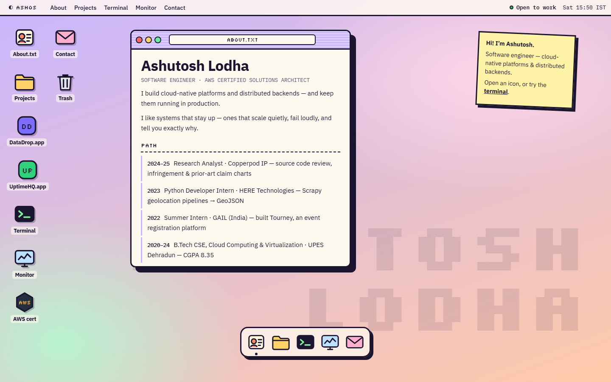

# AshOS — portfolio

**Live at [ashutoshdev.online](https://ashutoshdev.online)**

[](https://ashutoshdev.online)

My portfolio, built as a small desktop OS in the browser: draggable windows, a working terminal (`help`, `projects`, `neofetch`, `sudo hire-me` …), a live system monitor that pings my deployed projects, and one app per project. On phones it turns into a home-screen grid.

## Run locally

```bash
npm install
npm run dev     # http://localhost:5173
```

## Structure

| Path | What it is |
| --- | --- |
| `index.html` | Page shell |
| `os/main.js`, `os/style.css` | The OS: window manager, terminal, monitor, apps |
| `src/shared/content.js` | Profile, experience and projects — edit this to change the content |
| `src/shared/stats.json` | LeetCode / GitHub numbers, refreshed by `npm run stats` on every deploy |
| `scripts/fetch-stats.mjs` | Fetches those numbers |
| `public/` | Favicon and project screenshots |

## Deploy

Hosted on Vercel and connected to this repo: every push to `main` builds (`npm run stats && npm run build`, see `vercel.json`) and goes live on [ashutoshdev.online](https://ashutoshdev.online). Other branches and pull requests get preview URLs.
